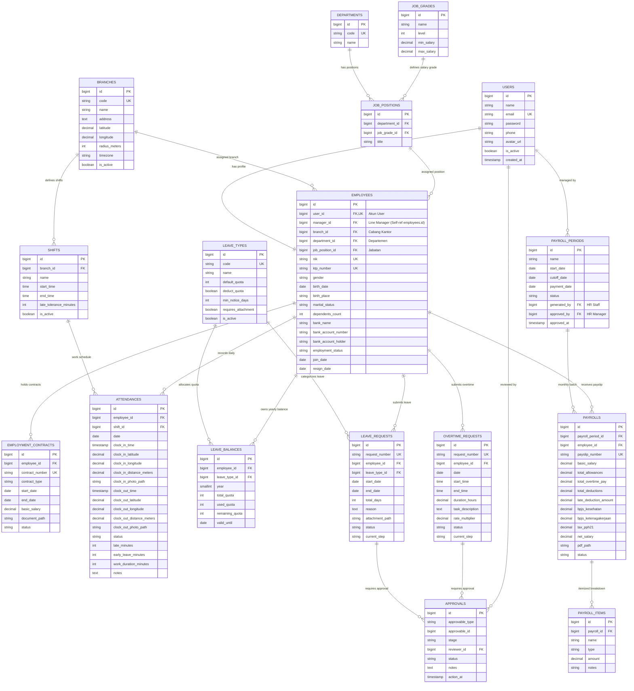

# HRIS Database Architecture & Entity Relationship Diagram (ERD)

Dokumentasi arsitektur database resmi untuk sistem **HRIS Enterprise Platform**, mencakup manajemen multi-cabang, hierarki karyawan (*multi-level workforce*), presensi otomatis berbasis GPS radius, *two-step approval workflow* (Manager & HR), serta *automated payroll engine*.

---

## 1. Visualisasi Entity Relationship Diagram (ERD Lengkap)

Diagram di bawah ini menyatukan **seluruh tabel, atribut, tipe data, kunci (PK/FK/UK), dan relasi antar modul** dalam satu diagram arsitektur utuh:



> [!NOTE]
> **Catatan Struktur Hierarki Atasan (Line Manager):**
> Pada tabel `EMPLOYEES`, kolom `manager_id` adalah *Foreign Key* yang mereferensikan kembali ke `employees.id` (atasan langsung). Pada diagram di atas relasi ini dinyatakan secara eksplisit pada atribut `bigint manager_id FK "Line Manager (Self-ref employees.id)"` tanpa menarik garis memutar (*self-loop*) agar Mermaid dapat me-render diagram secara presisi tanpa ada garis yang saling memotong/menabrak isi tabel.

---

## 2. Rincian Kamus Data (Data Dictionary)

### Modul 1: Organization & Branch Hierarchy
| Nama Tabel | Deskripsi | Kunci Utama (PK) | Kunci Asing (FK) & Relasi |
| :--- | :--- | :--- | :--- |
| `branches` | Data kantor pusat & cabang beserta titik GPS koordinat (lat/lng) dan radius validasi (default 100m). | `id` | - |
| `departments` | Unit kerja organisasi (e.g. IT, HR, Finance, Operations). | `id` | - |
| `job_grades` | Penjenjangan level jabatan beserta rentang gaji minimum & maksimum. | `id` | - |
| `job_positions` | Posisi pekerjaan spesifik yang terafiliasi dengan departemen dan grade gaji. | `id` | `department_id`, `job_grade_id` |

### Modul 2: User, Role & Employee Management
| Nama Tabel | Deskripsi | Kunci Utama (PK) | Kunci Asing (FK) & Relasi |
| :--- | :--- | :--- | :--- |
| `users` | Akun autentikasi sistem. Hak akses dikelola oleh Spatie Role-Based Access Control (`roles`, `permissions`). | `id` | - |
| `employees` | Profil lengkap data kepegawaian. Menyimpan referensi `manager_id` (Line Manager) untuk alur approval. | `id` | `user_id` (1:1), `manager_id` (self), `branch_id`, `department_id`, `job_position_id` |
| `employment_contracts`| Riwayat kontrak kerja karyawan (PKWT, PKWTT, Internship) dan histori gaji pokok resmi. | `id` | `employee_id` |

### Modul 3: Automated Attendance (GPS & Tolerance)
| Nama Tabel | Deskripsi | Kunci Utama (PK) | Constraint & Logika Bisnis |
| :--- | :--- | :--- | :--- |
| `shifts` | Jadwal jam kerja operasional kantor dengan toleransi keterlambatan 15 menit. | `id` | `late_tolerance_minutes = 15` |
| `attendances` | Log presensi harian karyawan. Menyimpan titik GPS dan jarak aktual saat clock-in/out. | `id` | `UNIQUE(employee_id, date)`. Jika waktu check-in melebihi `shift.start_time + 15 menit`, tercatat `late_minutes`. |

### Modul 4: Leave, Permit & Overtime (Time-Off)
| Nama Tabel | Deskripsi | Kunci Utama (PK) | Constraint & Logika Bisnis |
| :--- | :--- | :--- | :--- |
| `leave_types` | Master jenis cuti. Menyimpan aturan H-3 pengajuan (`min_notice_days = 3`) dan syarat surat dokter (`requires_attachment`). | `id` | `code` UNIQUE |
| `leave_balances` | Kuota tahunan cuti per karyawan per tahun. | `id` | `UNIQUE(employee_id, leave_type_id, year)`. Constraint `remaining_quota >= 0`. |
| `leave_requests` | Formulir pengajuan cuti/sakit/izin. Menyimpan file attachment bukti surat dokter. | `id` | `request_number` UNIQUE |
| `overtime_requests`| Pengajuan lembur kerja karyawan. Dibatasi maksimal 4.0 jam per hari kerja. | `id` | `request_number` UNIQUE, `duration_hours <= 4.0` |

### Modul 5: Two-Step Approval Workflow
| Nama Tabel | Deskripsi | Kunci Utama (PK) | Polimorfik & Tahapan |
| :--- | :--- | :--- | :--- |
| `approvals` | Jejak audit persetujuan bertingkat untuk Cuti dan Lembur. | `id` | `approvable_type` (`LeaveRequest` / `OvertimeRequest`), `approvable_id`, `stage` (`manager` -> `hr`), `reviewer_id` (`users.id`). |

### Modul 6: Automated Payroll Engine & Payslips
| Nama Tabel | Deskripsi | Kunci Utama (PK) | Logika Bisnis & Otorisasi |
| :--- | :--- | :--- | :--- |
| `payroll_periods` | Periode penggajian bulanan berdasarkan tanggal cut-off (e.g. tanggal 25). | `id` | Draft digenerate oleh HR Staff (`generated_by`), disahkan oleh HR Manager (`approved_by`). |
| `payrolls` | Kalkulasi gaji bersih per karyawan (gaji pokok + tunjangan + lembur - potongan telat - BPJS - PPh 21). | `id` | `UNIQUE(payroll_period_id, employee_id)`. Terintegrasi dengan link file slip gaji PDF. |
| `payroll_items` | Rincian breakdown setiap komponen penambah dan pengurang gaji. | `id` | `payroll_id` ON DELETE CASCADE |

---

## 3. Strategi Indexing & Optimasi Query (High Performance)

```sql
-- 1. Optimasi query riwayat absensi bulanan karyawan (Fast Cut-off Aggregation)
CREATE INDEX idx_attendances_emp_date ON attendances(employee_id, date);
CREATE INDEX idx_attendances_date_status ON attendances(date, status);

-- 2. Optimasi query bawahan langsung pada Dashboard Manager
CREATE INDEX idx_employees_manager ON employees(manager_id);
CREATE INDEX idx_employees_branch_dept ON employees(branch_id, department_id);

-- 3. Optimasi query pengajuan yang butuh review segera (Pending Approval Tasks)
CREATE INDEX idx_leave_requests_step ON leave_requests(current_step, status);
CREATE INDEX idx_overtime_requests_step ON overtime_requests(current_step, status);

-- 4. Optimasi pencarian audit jejak persetujuan (Polymorphic Index)
CREATE INDEX idx_approvals_target ON approvals(approvable_type, approvable_id, stage);
```

---

## 4. Keamanan Transaksi Database (ACID Safety)

1. **Pencegahan Sisa Saldo Cuti Minus (*No Race Conditions*)**:
   Saat HR Manager memberikan persetujuan akhir pada `leave_requests`, sistem menjalankan:
   ```php
   DB::transaction(function () use ($leaveRequest) {
       $balance = LeaveBalance::where('employee_id', $leaveRequest->employee_id)
           ->where('leave_type_id', $leaveRequest->leave_type_id)
           ->where('year', now()->year)
           ->lockForUpdate() // Row locking mencegah double deduct
           ->firstOrFail();

       if ($balance->remaining_quota < $leaveRequest->total_days) {
           throw new InsufficientLeaveBalanceException();
       }

       $balance->decrement('remaining_quota', $leaveRequest->total_days);
       $balance->increment('used_quota', $leaveRequest->total_days);
       
       $leaveRequest->update(['status' => 'approved', 'current_step' => 'completed']);
   });
   ```

2. **Konsistensi Generate Payroll Batch**:
   Kalkulasi ribuan data absensi menjadi draft slip gaji diproses per chunk dengan `DB::transaction` agar data nominal pendapatan, potongan keterlambatan, lembur, dan slip item selalu presisi 100%.
